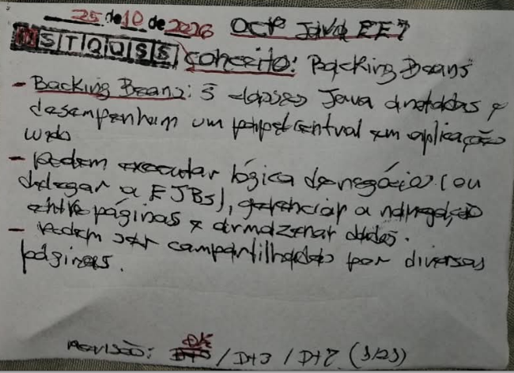
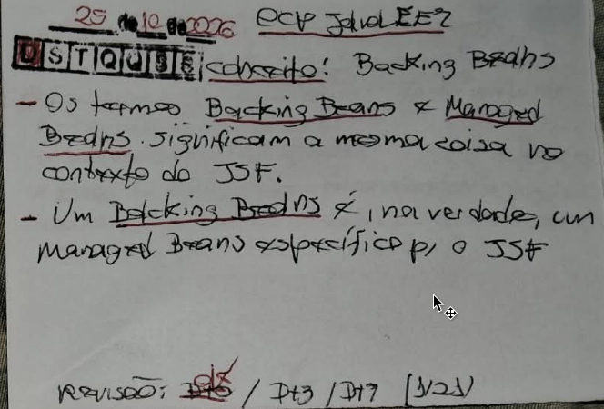

# Técnica Feynman

Tendo em mente o vídeo [Como APRENDER QUALQUER COISA de maneira INTELIGENTE | A Técnica Feynman](https://youtu.be/CN_SCpGuJ_w?si=7eqvv5fpdCkjXVdz)!

Aplicando o protocolo Feynman de 60 minutos especificamente para o CONCEITO: Backing Beans! E usar os áudios e cards para aplicar a [técnica revisão espaçada](https://youtu.be/XG0CAM_VYdE?si=-YqvN01n5A44NIGC).


## Escolha o Assunto (0-2 min)

CONCEITO: Backing Beans

Exame: 1Z0-900: Java EE 7 Application Developer · Módulo: 07-app-web-jsp

Base referêncial Livro: [Beginning Java EE 7 — Antonio Goncalves (Apress, 2013)](https://tenlong.com.tw/products/9781430246268); 

```
Beginning Java EE 7 (Antonio Goncalves)
» Capítulo 11 ■ Processamento e Navegação
» » Escrevendo Backing Beans
» » » Tratamento de Exceções e Mensagens
```
Complemento: [Java EE 7 Tutorial](https://docs.oracle.com/javaee/7/tutorial/partentbeans.htm).

```
Java EE 7 Tutorial
» Parte III ■ A Camada Web
» » Capítulo ■ 13 Usando Ajax com a tecnologia JavaServer Faces
» » » 13.6 Tratamento de erros
```

## Escrever à Mão (2-25 min)

Numa folha de papel (card), escreva:


```
O que é?
Como funciona?
Por que funciona?
Quando usar?
Quando NÃO usar?
Qual pegadinha?

```

### Evidências

E tire uma foto de evidência e coloque na pasta: `07-app-web-jsp/docs/feynman/backing-beans/evidencias/imgs`



---



## Explique em voz alta (25-40 min)

Explique sem consultas como se estivesse ensinando para um desenvolvedor Jr.

Use **uma analogia** por conceito (ex.: EJB Stateless = caixa de banco, qualquer atendente serve; Stateful = gerente da sua conta).

### Explicação simples

[TRABALHO EM PROGRESSO]

### Analogia

[TRABALHO EM PROGRESSO]


## Grave Áudio (40-50 min)

Gravar o áudio auto explicativo sem consultas, assim acionando, ativando e consolidando a rede do conhecimento.

O áudio pode começar com alguma coisa assim:

> "Hoje vou explicar como se eu estivesse ensinando um desenvolvedor Java júnior..."

Isso força você a abandonar o reconhecimento passivo e fazer recuperação ativa.

IMPORTANTE: Tendo em mente o vídeo: [Você Aprendeu Idiomas do Jeito Errado a Vida Toda — Richard Feynman Explica](https://youtu.be/7iFNXjXLY7Y?si=b9M_xaJjytUxnRKy), assim que possível, gravar áudios em inglês também para praticar as habilidades de escrita e fala! Assim, buscando recondicionar o cérebro para se adaptar e entender inglês!

## Verificar (50-60 min)

Fazer a revisão de correções do material, do roteiro do áudio!
Buscando complementando com mais detalhes ou deixar a explicação o mais simples possível para qualquer criança de 5 anos possa entender!

Onde a explicação travou ou ficou vaga é uma **lacuna**: volte ao livro/Tutorial e prove no código.

### Lacunas encontradas

- [ ] ...

### Versão de 10 linhas

> Até 10 linhas, sem jargão não definido. Regra de saída do dia: se não couber, o conceito volta na revisão do dia seguinte.


## Código :: Pratique

Pratique no laboratório do módulo e responda questões da prova de certificação em `questions-exam/`.
Cada erro vira um registro em `mistakes/` e uma linha no `study-plan/error-log.md`.

NOTA: 

```java

// Coloque o código aqui!!

```

Procure responder o seguinte:

```

Respondeu no mínimo 10 questões do simulador do exame?
Quais são as pegadinhas mais comuns no exame?

```
