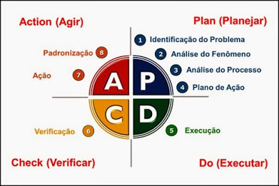

# Oracle Certifications: OCP Java SE 25 Developer

Se trata de um projeto prático prova de conceito - POC para deixar pegadas digitais e um comprometimento público para aplicar o foco e disciplia e com isso  ser próativo para os processos seletivos onde as equipes técnicas de recrutadores tenham condições e evidências para verificar se o meu perfil pode atender as necessidades das oportunidades.

## Visão do Projeto

Objetivo é focar  no uso prático real dos conceitos abstratos do conteúdo programático das certificações:

- Java SE
    - [Java SE 25 Developer
      (Exam Number: 1Z0-831)](https://mylearn.oracle.com/ou/exam/java-se-25-developer-professional-1z0-831/40805/161532/270890)

Tendo em mente que para a presente Certificação:

- O Conteúdo programático identificar os objetivos;
- Para cada Objetivo dos Tópicos, explodir em habilidades;
- Para cada habilidade, identificar boas práticas de uso Empírico;
- Identificar a forma de como é cobrado o conhecimento no exame;
- identificar, em projetos open-source, o uso dos conceitos, na prática;
- Elaborar estratégias (checklists) de refatoração para aplicar boas práticas em projetos legados;

--- 

## Proficiências

Procuro evidência as proficiências nas seguintes habilidades técnicas:

- [Metodologia Básica de Análise de Algoritmos](#GOODRICH-Michael-T)
- Técnicas em [Análise Código-fonte Legados](#FEATHERS-michael);
- Técnicas em [Refatoração Código-fonte Legados](#FEATHERS-michael);
- Implementar Soluções usando algoritmos Reutilizáveis


Projeto inicializado com o [`Scripts de automação próprio`]().

## 🚀 Começando

### 🔧 Instalação

Para obter o presente projeto use os seguintes comandos:

```bash
mkdir -p "${HOME}/projetos"
cd "${HOME}/projetos"
git clone https://github.com/pssilva/oracle-certifications.git
cd oracle-certifications
source ~/.bash_profile
idea .
```


#### 📋 Pré-requisitos

Depois de baixar o projeto: De que coisas precisamos para atuar no projeto `oracle-certifications` e executá-lo?

Para isso, use os comandos do script de automação:

```bash

export ARTIFACT_ID="oracle-certifications"
export TOOL_NAME="OracleCertificationsScriptsUteis"
export SCRIPT_PATH="${HOME}/projetos${ARTIFACT_ID}/scripts"
export AUTOMATION_PATH="${SCRIPT_PATH}/src/main/automation"
export TOOL_PATH="${AUTOMATION_PATH}/${TOOL_NAME}"

source "${TOOL_PATH}/OracleCertificationsScriptsUteis_main.sh"

OracleCertificationsScriptsUteis.installAllTools

```

Para verificar o ambiente SDK, use os comandos do script de automação:

```bash

export ARTIFACT_ID="oracle-certifications"
export TOOL_NAME="OracleCertificationsScriptsUteis"
export SCRIPT_PATH="${HOME}/projetos/${ARTIFACT_ID}/scripts"
export AUTOMATION_PATH="${SCRIPT_PATH}/src/main/automation"
export TOOL_PATH="${AUTOMATION_PATH}/${TOOL_NAME}"

source "${TOOL_PATH}/check-ambiente-sdk.sh"
OracleCertificationsScriptsUteis.checkAmbienteSDK

```
Para criar a estrutura da [Técnica Feynman](https://youtu.be/CN_SCpGuJ_w?si=7eqvv5fpdCkjXVdz)! 
Onde temos `OracleCertificationsScriptsUteis.CriarStructureByConceito "{{NOME_MODULO}}" "{{CONCEITO}}"`. 
Use os seguintes comandos:

```bash
export ARTIFACT_ID="oracle-certifications"
export TOOL_NAME="OracleCertificationsScriptsUteis"
export SCRIPT_PATH="${HOME}/projetos/${ARTIFACT_ID}/scripts"
export AUTOMATION_PATH="${SCRIPT_PATH}/src/main/automation"
export TOOL_PATH="${AUTOMATION_PATH}/${TOOL_NAME}"

source "${TOOL_PATH}/ocp-training-lab.sh"
OracleCertificationsScriptsUteis.CriarStructureByConceito "01-beyond-classes" "TituloConceitoXPTO_11"
```


Após instalar as ferramentas necessárias.
Executar o projeto `ocp-javase25-developer`, use os seguintes comandos:

```bash
export ARTIFACT_ID_PARENT="oracle-certifications"
export ARTIFACT_ID="ocp-javase25-developer"
cd "${HOME}/projetos/${ARTIFACT_ID_PARENT}/${ARTIFACT_ID}"
sdk install java 25.0.3-amzn
sdk default java 25.0.3-amzn
mvn clean install
source ~/.bash_profile
idea .
```

---

## 🔩 Débitos Técnicos

Aqui temos uma lista do que idenficamos com status de pendente:

### Funcionalidades Aplicação

Segue abaixo (não se limita) os objetivos do presente projeto:

- [X] ~~Formatando documentação README.md~~s

### Tópicos da Certificação

Tomando como base [Exam 1Z0-831: Java SE 25 Developer Professional](https://mylearn.oracle.com/ou/exam/java-se-25-developer-professional-1z0-831/40805/161532/270890), temos: 

- [ ] Tratamento de data, hora, texto, valores numéricos e booleanos
  - [ ] Use classes primitivas e wrapper.
  - [ ] Avaliar expressões aritméticas e booleanas, usando a API Math
  - [ ] Aplicando regras de precedência
  - [ ] conversões de tipo e casting.
  - [ ] Manipular texto, incluindo blocos de texto, usando as classes String e StringBuilder.
  - [ ] Manipular objetos de data, hora, duração, período, instante e fuso horário, incluindo horário de verão, usando a API Date-Time.

- [ ] Implementar Controle de Fluxo de Programa Usando Estruturas de Decisão e Repetição
  - [ ] Criar estruturas de controle de fluxo de programa, incluindo if/else
  - [ ] instruções e expressões switch
  - [ ] loops e instruções break e continue.

- [ ] Aplicar Princípios de Orientação a Objetos em Programas Java
  - [ ] Declarar e instanciar objetos Java
  - [ ] incluindo objetos de classe aninhados
  - [ ] explicar o ciclo de vida do objeto, incluindo criação, reatribuição de referências e coleta de lixo
  - [ ] Criar classes e registros
    - [ ] Classes definir e usar campos e métodos de instância e estáticos,
    - [ ] Construtores, incluindo corpos de construtores flexíveis
    - [ ] Inicializadores de instância e estáticos.

  - [ ] Implementar métodos sobrecarregados, incluindo métodos var-arg.

  - [ ] Compreender escopos de variáveis, aplicar encapsulamento e criar objetos imutáveis.
  - [ ] Utilize inferência de tipo de variável local e variáveis sem nome.

  - [ ] Implemente herança, incluindo tipos abstratos e selados
    - [ ] bem como classes de registro.
    - [ ] Sobrescreva métodos, incluindo os da classe Object. Implemente polimorfismo e diferencie entre tipo de objeto e tipo de referência.

  - [ ] Crie e utilize interfaces
    - [ ] identifique interfaces funcionais
    - [ ] utilize métodos de interface privados, estáticos e padrão.

  - [ ] Crie e utilize tipos enum com campos, métodos e construtores.

- [ ] Implementando tratamento de exceções em aplicações Java
  - [ ] Trate exceções usando blocos
    - [ ] try/catch/finally,
    - [ ] try-with-resources
    - [ ] multi-catch,
  - [ ] incluindo exceções personalizadas.

- [ ] Utilizando arrays e coleções para armazenar e recuperar dados
  - [ ] Crie arrays, List, Set, Map, Deque e coleções sequenciais
  - [ ] adicione, remova, atualize, recupere e ordene seus elementos

- [ ] Processando dados usando Streams e expressões lambda
  - [ ] Utilize objetos Java e Streams primitivos
    - [ ] incluindo expressões lambda que implementam interfaces funcionais, para criar, filtrar, transformar, processar e ordenar dados.
  - [ ] Realizar operações
    - [ ] decomposição,
    - [ ] concatenação,
    - [ ] redução
    - [ ] agrupamento e particionamento,
    - [ ] gathering (Gatherers),
  - [ ] além de operações de coleta em fluxos sequenciais e paralelos

- [ ] Empacotamento e Implantação de Código Java
  - [ ] Definir módulos e expor o conteúdo dos módulos
    - [ ] inclusive por meio de reflexão;
    - [ ] declarar dependências de módulos;
    - [ ] definir serviços, provedores e consumidores;
  - [ ] usar declarações de importação de módulos.

  - [ ] Compilar e executar código-fonte Java,
    - [ ] incluindo arquivos-fonte compactos, métodos main de instância
    - [ ] programas de código-fonte com vários arquivos;
    - [ ] criar JARs modulares e não modulares e imagens de tempo de execução;
    - [ ] implementar a migração para módulos usando módulos sem nome e módulos automáticos.

- [ ] Implementar Multithreading para Execução Concorrente de Código
  - [ ] Criar threads de plataforma e virtuais. Usar objetos Runnable e Callable, gerenciar o ciclo de vida da thread, usar diferentes serviços Executor e API concorrente para executar tarefas e usar valores com escopo para compartilhar contexto imutável.
  - [ ] Desenvolver código thread-safe, usando mecanismos de bloqueio e API concorrente.
  - [ ] Processar coleções Java concorrentemente e utilizar fluxos paralelos.

- [ ] Executando operações de entrada e saída usando a API de E/S do Java
  - [ ] Leia e escreva dados do console e de arquivos usando fluxos de E/S.

  - [ ] Serialize e desserialize objetos Java.

  - [ ] Construa, percorra, crie, leia e escreva objetos Path e suas propriedades usando a API java.nio.file.

- [ ] Desenvolvendo aplicativos com suporte à localização
  - [ ] Implemente a localização usando localidades
  - [ ] e pacotes de recursos.
  - [ ] Analise e formate mensagens, datas, horas e números, incluindo valores monetários e percentuais.

### Mapa: Módulos × Tópicos do Exame 1Z0-831

Os módulos seguem a **ordem dos capítulos do livro** (ordem de estudo); cada um cobre um ou mais tópicos do exame. Os conceitos de cada módulo ficam em `{{NOME_MODULO}}/docs/feynman/{{CONCEITO}}`.

| Ordem | Módulo | Capítulo do livro | Tópicos do exame |
|------:|--------|-------------------|------------------|
| 1 | [01-building-blocks](01-building-blocks/README.md) | 1 Building Blocks | 1 (primitivos, wrappers, casting), 3 (ciclo de vida, escopo, `var`, variáveis sem nome) |
| 2 | [14-operators](14-operators/README.md) | 2 Operators | 1 (expressões, precedência) |
| 3 | [02-making-decisions](02-making-decisions/README.md) | 3 Making Decisions | 2 (if/else, switch, loops, break/continue) |
| 4 | [15-core-apis](15-core-apis/README.md) | 4 Core APIs | 1 (String, StringBuilder, text blocks, Math, Date-Time), 5 (arrays) |
| 5 | [03-methods](03-methods/README.md) | 5 Methods | 3 (métodos, static, sobrecarga, varargs, encapsulamento) |
| 6 | [01-class-design](01-class-design/README.md) | 6 Class Design | 3 (herança, construtores flexíveis, inicializadores, abstratas, imutáveis, sobrescrita) |
| 7 | [01-beyond-classes](01-beyond-classes/README.md) | 7 Beyond Classes | 3 (interfaces, enums, sealed, records, aninhadas, polimorfismo) |
| 8 | [06-lambdas-functional-interfaces](06-lambdas-functional-interfaces/README.md) | 8 Lambdas and Functional Interfaces | 3 (interfaces funcionais), 6 (lambdas) |
| 9 | [05-collections-generics](05-collections-generics/README.md) | 9 Collections and Generics | 5 (List, Set, Map, Deque, sequenced, ordenação) |
| 10 | [07-streams](07-streams/README.md) | 10 Streams | 6 (streams, primitivos, redução, agrupamento, gatherers) |
| 11 | [04-exceptions-localization](04-exceptions-localization/README.md) | 11 Exceptions and Localization | 4 (exceções), 10 (localização) |
| 12 | [11-modules](11-modules/README.md) | 12 Modules | 7 (módulos, serviços, migração, `import module`) |
| 13 | [12-packaging-deployment](12-packaging-deployment/README.md) | 12 Modules + JEPs Java 25 | 7 (arquivos-fonte compactos, `main` de instância, multi-arquivo, JARs, `jlink`) |
| 14 | [13-concurrency](13-concurrency/README.md) | 13 Concurrency | 8 (threads virtuais, executors, scoped values, thread-safety, parallel streams) |
| 15 | [09-io-api](09-io-api/README.md) | 14 I/O | 9 (I/O streams, console, serialização, NIO.2) |

> Conteúdos do Java 22–25 que **não** estão no livro OCP 21 (estudar pelas JEPs): variáveis sem nome (JEP 456), Gatherers (JEP 485), `import module` (JEP 511), arquivos-fonte compactos e `main` de instância (JEP 512), corpos de construtores flexíveis (JEP 513), scoped values (JEP 506) e programas multi-arquivo (JEP 458).

### Atividades - DevOps

- [ ] Scritps de Automação
  - [X] ~~instalação das Ferramentas de Desenvolvimento.~~
  - [ ] Criar automação para as principais funcionalidade (features) disponíveis no Java SE
- [ ] [Metodologia Básica de Análise de Algoritmos](#GOODRICH-Michael-T)
  - Aplicar técncia para [Análise Explorativa da Implementação dos Artefatos](#da-analise-exploratoria)
- [ ] [Implementar Testes (TDD)](#GONZALEZ_Javier_cap_11): Técnica Red-Green-Refact
- [ ] Descrição sucinta [TRABALHO EM PROGRESSO]

- [ ] Implementação dos Pipelines CI/CD de Implatação num Provedor de Nuvem (detalhes em `docs/provedores_nuvem/` — a documentar).
- [ ] Implementar restrições de Commit no Git: vinculado com o ID de regra de negócio e ID do checklist de validação das entragas de funcionalidades (mais detalhes [aqui](../docs/checklists/README.md))
- [ ] Implementar Dockerfiles para Kubernetes
- [ ] Colocar em prática o Desenvolvimento Orientado a Interface onde se deve desacoplar a aplicação do procedor de nuvem (Princípio da Segregação de Interface (ISP) - SOLID) (detalhes em `docs/provedores_nuvem/` — a documentar)
- [ ] Implementar Arquitetura Orienta a Eventos ([EDA](https://aws.amazon.com/pt/what-is/eda/))

### Suporte / Sustentação

- [ ] Abordagem API First e Implementação da Especificação do [OpenAPI (antido Swagger)](https://swagger.io/specification/) para integração com o back-end
- [ ] Clusterização da Solução em Diversas [VM em multicloud Nuvem]() para integração com o back-end

---

## 📦 Desenvolvimento

- [ ] Inplementar o gernciador de tarefas Gruntfile.js

### Mentalidade PDCA

Tendo em mente que sempre buscamos melhorar o protocolo de trabalho operacinal do dia a dia usando empirismo (colocar realmente em prática os conheicmentos abstratos):



---

<a href="#FOWLER-Martin" id="da-analise-exploratoria">

</a>

---

## 🛠️ Construído com

Seque aqui as ferramentas utilizadas na construção presente projeto:

### Ferramentas

* [Docker](https://www.docker.com/get-started/)
* [NVM](https://github.com/nvm-sh/nvm?tab=readme-ov-file#intro) - Node Version Manager
* [Terminal Shell Linux (WSL)](https://learn.microsoft.com/pt-br/windows/wsl/install)


## 🖇️ Colaborando

Por favor, leia o `COLABORACAO.md` (a criar) para obter detalhes sobre o nosso código de conduta e o processo para nos enviar pedidos de solicitação.

## 📌 Versão

Nós usamos [SemVer](http://semver.org/) para controle de versão. Para as versões disponíveis, observe as [tags neste repositório](https://github.com/pssilva/oracle-certifications/tags).

## ✒️ Autores

Mencione todos aqueles que ajudaram a levantar o projeto desde o seu início

* **Um desenvolvedor** - *Trabalho Inicial* - [pssilva](https://github.com/pssilva)


Você também pode ver a lista de todos os colaboradores (`COLABORACAO.md`, a criar) que participaram deste projeto.

---

## 📄 Licença

Este projeto está sob a licença (sua licença) - arquivo `LICENSE` a criar.

---

## 🎁 Expressões de Gratidão

Primeiro confesso aqui publicamente a minha gratidão ao Criado! E reconheço Jesus Cristo como o meu Senhor e Salvador! E que tudo é para honra e glória do Altissímo! Amém!! 📢

Expresso gratidão pelas contribuções para comunidade aos seguintes Canais do Youtube:

- [Devs JavaGirl BR (@DevsJavaGirlBR)](https://www.youtube.com/@DevsJavaGirlBR)
- [Giuliana Bezerra (@giulianabezerra)](https://www.youtube.com/@giulianabezerra)
- [Fernanda Kipper | Dev (@kipperdev)](https://www.youtube.com/@kipperdev)
- [Loiane Groner (@loianegroner)](https://www.youtube.com/@loianegroner)
- [RinaldoDev (@rinaldodev)](https://www.youtube.com/@rinaldodev)

---

## Referências Usadas

Seque abaixo as referências bibliográficas usadas no presente projeto:

### Livros

---

<p align="justify">
[<a id="BOYARSKY-Jeanne">BOYARSKY, Jeanne</a>]; [<a id="SELIKOFF-Scott">SELIKOFF, Scott</a>]: OCP Oracle® Certified Professional Java® SE 21 Developer: Study Guide Exam 1Z0-830 ISBNs: 9781394286614 (paperback), 9781394286638 (ePDF), 9781394286621 (ePub). Published by John Wiley & Sons, Inc., Hoboken, New Jersey. Published simultaneously in Canada and the United Kingdom. 1040 pages. 1st Edition,  November 27, 2024 Disponível em: < <a href="https://a.co/d/0alQOByp">https://a.co/d/0alQOByp</a>>.Acesso em: 16 mai. 2026.
</p>

---

### Vídeos / Playlists

---

Veja mais detalhes da estratégia de Indexação de vídeos [aqui](https://github.com/pssilva/oracle-certifications/blob/main/docs/indexacoes/README.md)